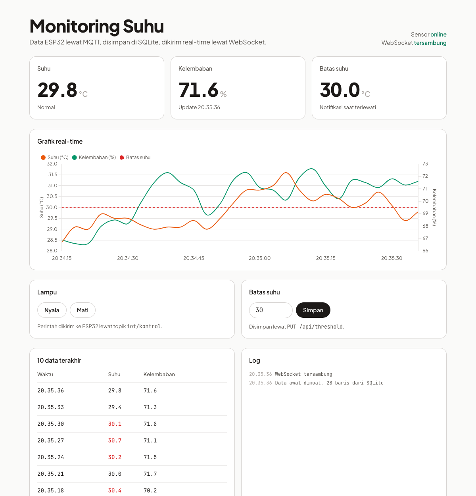
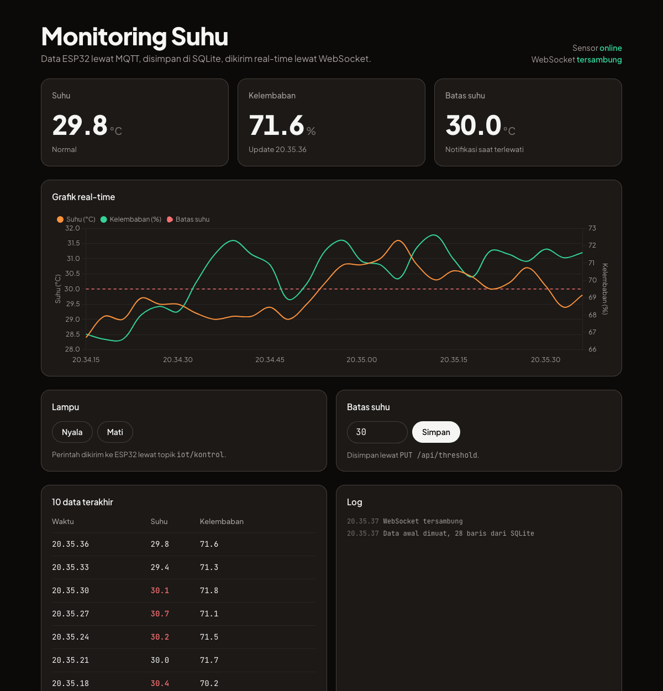
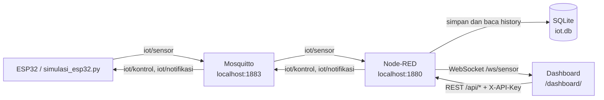
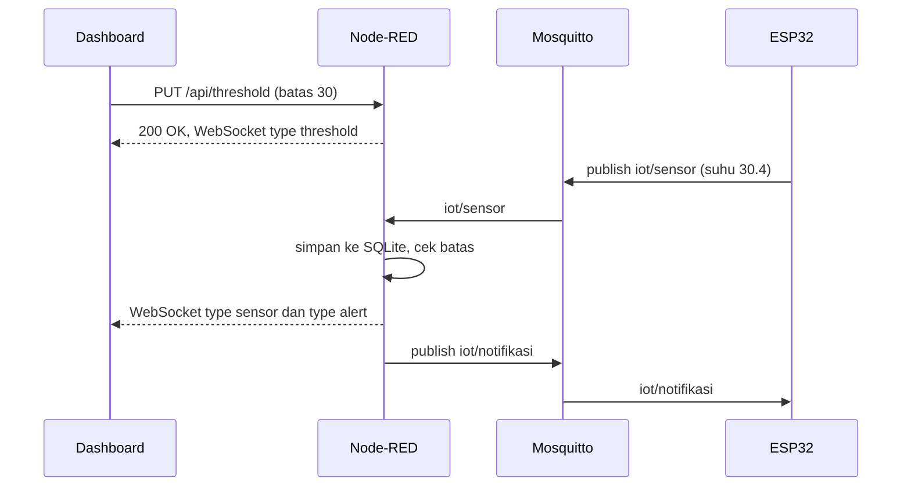
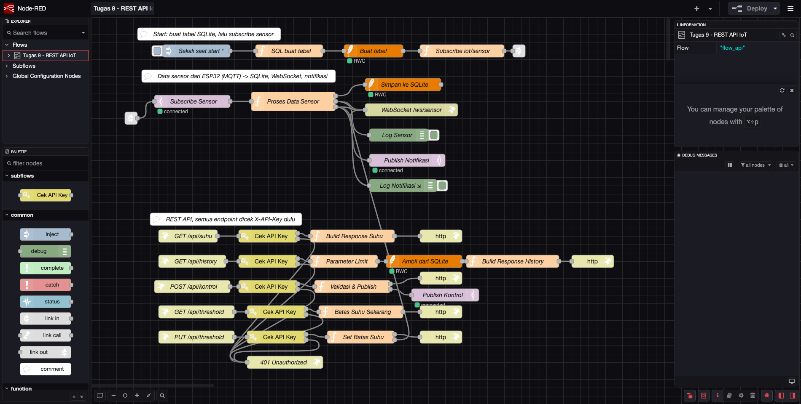

# REST API Node-RED untuk Sistem IoT

[](https://github.com/fxjrin/piot-rest-api-nodered/actions/workflows/test.yml)

Tugas Praktek 9 - Pemrograman Internet of Things (SIF1502)

| | |
|---|---|
| Nama | Fajrin Firmana |
| NPM | 2410020079 |
| Kelas | SI 5A Reg BJB |

Sistem monitoring dan kontrol IoT: ESP32 (simulator Python) mengirim data suhu dan kelembaban lewat MQTT, Node-RED menjadi backend REST API, dan dashboard web buatan sendiri menampilkan datanya. Kelima tugas pengembangan sudah dikerjakan.



Dashboard otomatis mengikuti mode gelap perangkat:



## Arsitektur



Alur notifikasi saat suhu melewati batas:





## Struktur Folder

```
nodered/flows.json     flow Node-RED (backend API)
nodered/settings.js    port, folder dashboard, CORS
public/index.html      dashboard (HTML, CSS, JS, Chart.js)
simulasi_esp32.py      simulator ESP32 (publish sensor, terima kontrol LED dan notifikasi)
test/api.test.mjs      pengujian otomatis semua endpoint, WebSocket, SQLite, notifikasi
```

## Cara Menjalankan

Prasyarat: Node.js 22+, Python 3, dan Mosquitto yang berjalan di `localhost:1883`.

```bash
# Terminal 1: broker MQTT
mosquitto -v

# Terminal 2: Node-RED (editor di http://localhost:1880)
npm install
npm start

# Terminal 3: simulator ESP32
pip install -r requirements.txt
python simulasi_esp32.py
```

Buka dashboard di **http://localhost:1880/dashboard/**.

API key default adalah `iot-2410020079`. Untuk menggantinya, jalankan Node-RED dengan `API_KEY=kunci-baru npm start` lalu ubah konstanta `API_KEY` di `public/index.html`.

Jika ingin memakai Node-RED yang sudah terpasang sendiri: pasang node `node-red-node-sqlite` lewat Manage palette, lalu Import `nodered/flows.json`.

## Endpoint

Semua endpoint wajib mengirim header `X-API-Key`. Tanpa key yang benar, respons `401`.

| Method | URL | Fungsi |
|---|---|---|
| GET | `/api/suhu` | Data sensor terakhir |
| GET | `/api/history?limit=50` | History dari SQLite (default 50, maks 500) |
| POST | `/api/kontrol` | Kirim perintah ke ESP32, body `{"device":"lamp","action":"on"}` |
| GET | `/api/threshold` | Batas suhu sekarang |
| PUT | `/api/threshold` | Ubah batas suhu, body `{"batas":30}` |
| WS | `/ws/sensor` | Aliran data real-time (sensor, notifikasi, perubahan batas) |

## Uji Coba dengan curl

```bash
$ curl http://localhost:1880/api/suhu
{"status":"error","message":"API key salah atau tidak ada (header X-API-Key)"}   # 401

$ curl -H "X-API-Key: iot-2410020079" http://localhost:1880/api/suhu
{"status":"success","data":{"suhu":27.4,"kelembaban":59.4,"timestamp":"2026-11-21T20:20:15","received":"2026-11-21T12:20:15.363Z"},"server_time":"2026-11-21T12:20:15.659Z"}

$ curl -H "X-API-Key: iot-2410020079" "http://localhost:1880/api/history?limit=2"
{"status":"success","count":2,"data":[{"suhu":26.9,"kelembaban":59.6,"timestamp":"2026-11-21T20:20:12","received":"2026-11-21T12:20:12.358Z"},{"suhu":27.4,"kelembaban":59.4,"timestamp":"2026-11-21T20:20:15","received":"2026-11-21T12:20:15.363Z"}]}

$ curl -X POST -H "X-API-Key: iot-2410020079" -H "Content-Type: application/json" \
    -d '{"device":"lamp","action":"on"}' http://localhost:1880/api/kontrol
{"status":"success","message":"Perintah terkirim","sent":{"device":"lamp","action":"on"}}

$ curl -X PUT -H "X-API-Key: iot-2410020079" -H "Content-Type: application/json" \
    -d '{"batas":27}' http://localhost:1880/api/threshold
{"status":"success","message":"Batas suhu disimpan","batas":27}
```

Output simulator setelah perintah kontrol dan batas suhu di atas:

```
-> Publish: {'suhu': 27.4, 'kelembaban': 59.4, 'timestamp': '2026-11-21T20:20:15'}
<- Kontrol: LED ON
-> Publish: {'suhu': 27.1, 'kelembaban': 57.6, 'timestamp': '2026-11-21T20:20:18'}
<- NOTIFIKASI: Suhu 27.1 C melewati batas 27 C
```

## Pengujian Otomatis

`npm test` menyalakan Node-RED sendiri di port 18890 dengan database sementara, mengirim data sensor lewat MQTT, lalu memeriksa semua endpoint, WebSocket, isi SQLite, dan notifikasi. Butuh Mosquitto berjalan di `localhost:1883`, dan simulator harus dimatikan dulu supaya datanya tidak tercampur. Test yang sama dijalankan GitHub Actions di setiap push.

```
$ npm test
ok dashboard
  ok disajikan Node-RED di /dashboard/
ok autentikasi X-API-Key
  ok GET /api/suhu tanpa key ditolak 401
  ok GET /api/history tanpa key ditolak 401
  ok POST /api/kontrol tanpa key ditolak 401
  ok GET /api/threshold tanpa key ditolak 401
  ok PUT /api/threshold tanpa key ditolak 401
  ok key yang salah ditolak 401
  ok preflight CORS mengizinkan header X-API-Key dan method PUT
ok data sensor
  ok data MQTT diteruskan ke WebSocket dan GET /api/suhu
  ok data yang bukan angka diabaikan
  ok history tersimpan di SQLite, urut dari lama ke baru
ok kontrol perangkat
  ok body tanpa action ditolak 400
  ok perintah valid dipublish ke MQTT iot/kontrol
ok threshold dan notifikasi
  ok batas default 30
  ok batas yang bukan angka atau di luar rentang ditolak 400
  ok PUT menyimpan batas dan menyiarkannya lewat WebSocket
  ok suhu melewati batas mengirim notifikasi ke MQTT dan WebSocket
  ok notifikasi tidak berulang selama suhu masih di atas batas
  ok notifikasi muncul lagi setelah suhu turun lalu naik lagi
# tests 19, pass 19, fail 0
```

## Tugas Pengembangan

1. **Endpoint `/api/threshold` (PUT) dan notifikasi.** Batas suhu disimpan di flow context (default 30 C). Saat suhu baru melewati batas, Node-RED mengirim notifikasi ke topik MQTT `iot/notifikasi`, ke debug sidebar, dan ke dashboard lewat WebSocket (muncul toast merah dan notifikasi browser). Notifikasi hanya dikirim sekali setiap kali suhu naik melewati batas, tidak berulang selama suhu masih di atas batas.
2. **Grafik real-time Chart.js.** Grafik garis suhu dan kelembaban (dua sumbu Y) dengan garis putus-putus untuk batas suhu, menampilkan 30 data terakhir.
3. **Autentikasi API key.** Subflow `Cek API Key` dipasang di depan setiap endpoint dan mencocokkan header `X-API-Key` dengan env `API_KEY`. Jika salah, respons `401`.
4. **WebSocket tanpa polling.** Node `websocket out` di `/ws/sensor` mendorong setiap data sensor baru ke dashboard. Dashboard hanya memanggil REST sekali saat dibuka (data awal), sisanya lewat WebSocket, dan otomatis menyambung ulang jika koneksi putus.
5. **History di SQLite.** Setiap data sensor disimpan ke tabel `sensor` di `iot.db` memakai `node-red-node-sqlite`, sehingga history tidak hilang saat Node-RED restart. Node-RED baru subscribe `iot/sensor` setelah tabel selesai dibuat, supaya data yang datang tepat saat start tidak gagal disimpan. Endpoint `/api/history` membaca langsung dari database.
